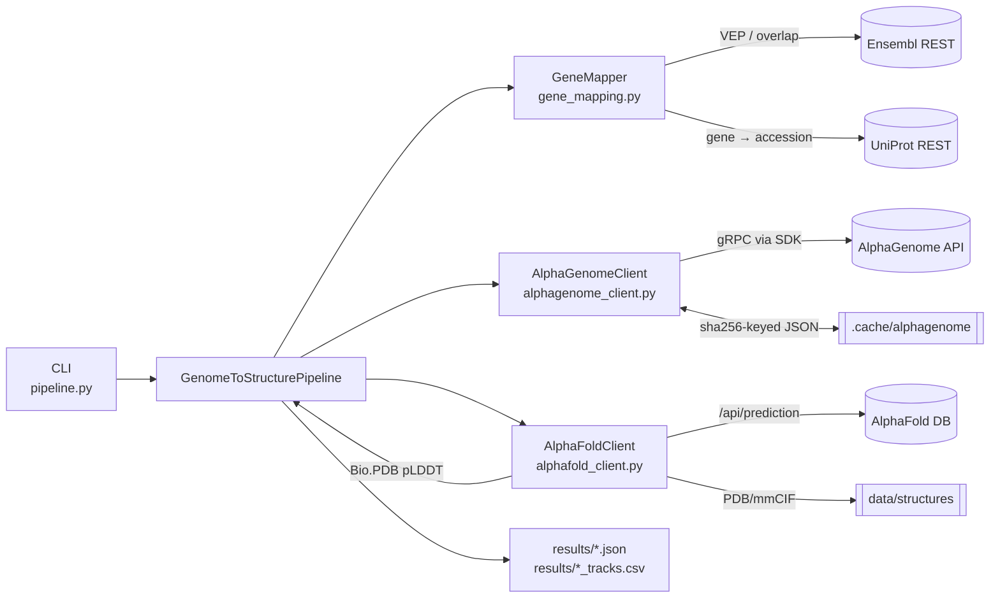

# geneme-structure

**From a genetic variant to its predicted regulatory effect to the 3D protein it hits, in one command.**

`geneme-structure` links three data sources:

1. **Ensembl VEP / REST** finds the gene, the consequence, the protein position and the UniProt accession for a GRCh38 variant or region.
2. **[AlphaGenome](https://deepmind.google.com/science/alphagenome)** (Google DeepMind) predicts REF vs ALT regulatory tracks (RNA-seq, CAGE, DNase, ATAC, ChIP, splicing) across up to 1 Mb of sequence context, using the AlphaGenome 2 SDK.
3. **[AlphaFold Protein Structure Database](https://alphafold.ebi.ac.uk)** (EMBL-EBI) supplies the predicted 3D structure, with per-residue pLDDT confidence at the mutated residue.

## Architecture



| Module | Responsibility |
|---|---|
| `config.py` | Reads settings strictly from env vars (`.env` via python-dotenv). The API key is held as a `SecretStr`. |
| `models.py` | Pydantic models: `GenomicVariant`, `GenomicInterval`, `VariantAnnotation`, `TrackSummary`, `AlphaFoldEntry`, `PipelineResult` |
| `alphagenome_client.py` | Wraps the official SDK, adds a content-addressed JSON cache and a throttle, and reduces numpy tracks to compact summaries |
| `alphafold_client.py` | AlphaFold DB metadata, cached structure download, per-residue pLDDT parsing |
| `gene_mapping.py` | Variant/region → gene → UniProt (Ensembl VEP, Ensembl overlap, UniProt search) |
| `http_session.py` | Shared `requests` session that retries 429/5xx and honours `Retry-After` |
| `pipeline.py` | Orchestration, reporting, and the CLI |

### Design notes

- **AlphaGenome has no public REST endpoint.** Access goes through the official `alphagenome` Python SDK (gRPC, `alphagenome.models.v2`). The SDK is an optional extra, imported lazily, so the structure and annotation features work without it.
- **Caching:** each AlphaGenome request is canonicalised (variant, window, ontology terms, outputs) and hashed with SHA-256. The reduced result is stored as JSON under `.cache/alphagenome/`. Repeated runs cost zero API quota. Pass `--no-cache` to force a live call.
- **Conditions:** AlphaGenome 2 predicts for one *condition*, built from at most one ontology term per type. `--ontology UBERON:0000178 CL:0001054` becomes `'UBERON:0000178_CL:0001054'` (blood, CD14+ monocytes). To compare tissues, run separate queries; each is cached independently.
- **Coordinates:** GRCh38 throughout. Variants are 1-based (VCF). Intervals are parsed from 1-based UCSC strings and stored 0-based half-open (BED/AlphaGenome).
- **Secrets:** the key is read only from `os.getenv("ALPHAGENOME_API_KEY")`. The placeholder value counts as unset, and the key is masked in every `repr`.

## Installation

```bash
git clone <your-fork-url> geneme-structure && cd geneme-structure
python -m venv .venv && source .venv/bin/activate
pip install -e ".[alphagenome,dev]"

cp .env.example .env    # then edit .env and set ALPHAGENOME_API_KEY
```

You can request a free non-commercial AlphaGenome API key at <https://deepmind.google.com/science/alphagenome>.

## Usage

> Quote variant strings: an unquoted `>` in `C>T` is a shell redirect.

```bash
# TP53 R175H hotspot: regulatory effect in transverse colon + AlphaFold model
geneme-structure variant 'chr17:7675088:C>T' --ontology UBERON:0001157 --outputs RNA_SEQ DNASE

# Cell-type-specific condition (tissue + cell type)
geneme-structure variant 'chr17:7675088:C>T' --ontology UBERON:0000178 CL:0001054

# Protein-coding genes in a region, their predicted signal, and structures
geneme-structure region chr17:7668421-7687490 --max-genes 5

# Structure only (no API key required)
geneme-structure structure P04637 --residue 175

# Annotation + structure, skipping AlphaGenome
geneme-structure variant 'chr17:7675088:C>T' --no-alphagenome
```

Each run prints a summary and writes:

- `results/<query>.json`: the full validated `PipelineResult`
- `results/<query>_tracks.csv`: a per-output-type AlphaGenome table (REF/ALT sums, log2FC, max |Δ|, top track)
- `data/structures/AF-<acc>-F1-model_v*.pdb`: the downloaded structure

### Python API

```python
from geneme_structure.config import Settings
from geneme_structure.models import GenomicVariant
from geneme_structure.pipeline import GenomeToStructurePipeline

pipeline = GenomeToStructurePipeline(Settings.from_env())
result = pipeline.run_variant(
    GenomicVariant.parse("chr17:7675088:C>T"),
    ontology_terms=["UBERON:0001157"],
    output_types=["RNA_SEQ", "ATAC"],
)
print(result.structures[0].residue_plddt)
```

## Configuration

| Variable | Default | Purpose |
|---|---|---|
| `ALPHAGENOME_API_KEY` | (required for predictions) | AlphaGenome API key |
| `GENEME_CACHE_DIR` | `.cache` | AlphaGenome response cache |
| `GENEME_DATA_DIR` | `data` | Downloaded structures |
| `GENEME_HTTP_TIMEOUT` | `30` | REST timeout (seconds) |

## Development

```bash
pytest          # offline unit tests (no network, no API key)
ruff check .
```

## Limitations

- Human (GRCh38) only.
- Track summaries are deliberately coarse (window sums and max |Δ|). For publication-grade variant effect scores, use AlphaGenome's `score_variant` with the recommended variant scorers.
- AlphaFold DB models are monomer predictions. pLDDT measures model confidence, not the effect of the mutation.

## Licence & attribution

Code: MIT. AlphaGenome outputs are subject to the [AlphaGenome Terms of Use](https://deepmind.google.com/science/alphagenome). AlphaFold DB data is CC-BY-4.0 (Jumper et al. 2021; Varadi et al. 2024).
