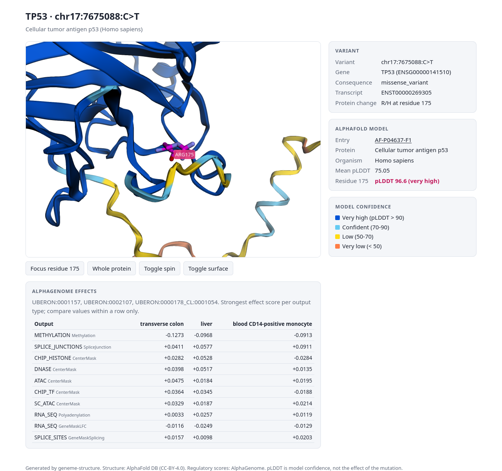
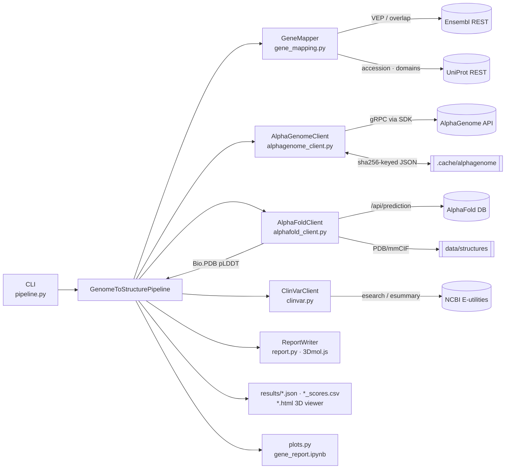
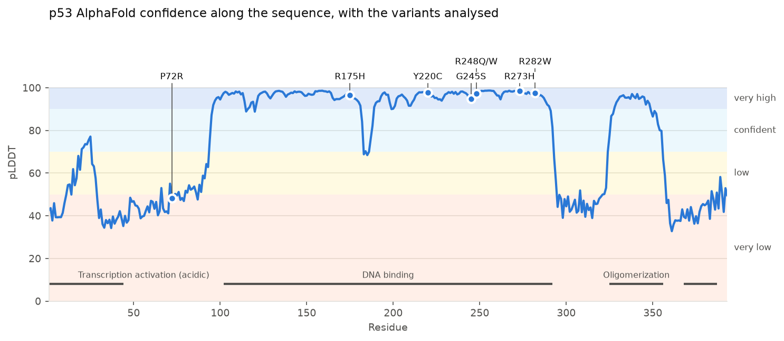
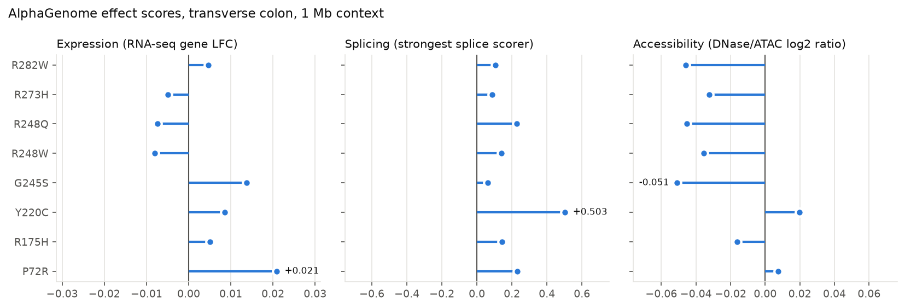
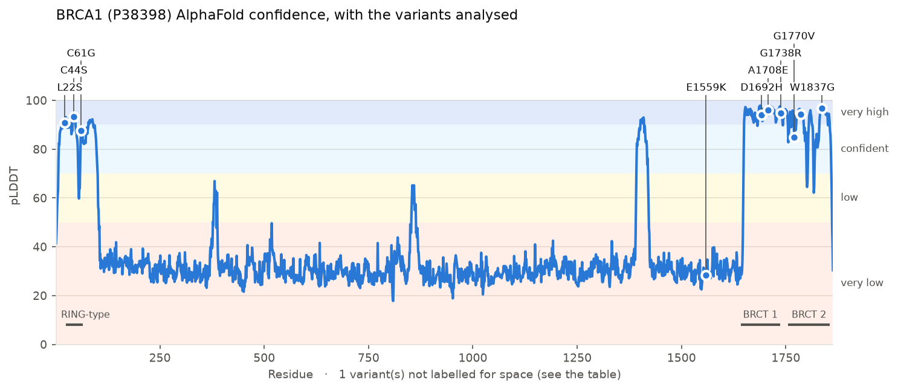
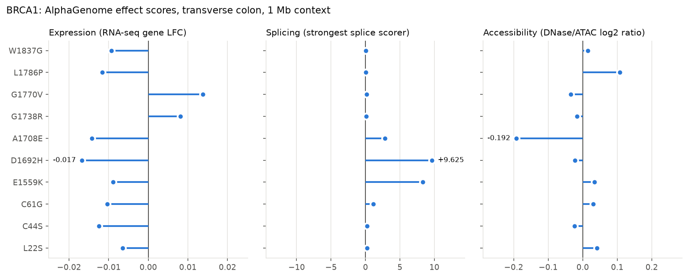

# geneme-structure

[](https://github.com/amarcos20/geneme-structure/actions/workflows/ci.yml)

**From a genetic variant to its predicted regulatory effect to the 3D protein it hits, in one command.**

**[Live demo: interactive 3D viewers and reports for BRCA1 and TP53](https://amarcos20.github.io/geneme-structure/)**

`geneme-structure` starts from a variant, a VCF, a region, or just a **gene symbol** (its known pathogenic variants are pulled from ClinVar), and links three data sources:

1. **Ensembl VEP / REST** finds the gene, the consequence, the protein position and the UniProt accession for a GRCh38 variant or region. It also returns the allele-specific ClinVar significance, rsID and gnomAD frequency.
2. **[AlphaGenome](https://deepmind.google.com/science/alphagenome)** (Google DeepMind) scores the variant with the model's recommended variant scorers (expression, chromatin accessibility, histone marks, TF binding, methylation, splicing, 3D contacts) over up to 1 Mb of sequence context, using the AlphaGenome 2 SDK.
3. **[AlphaFold Protein Structure Database](https://alphafold.ebi.ac.uk)** (EMBL-EBI) supplies the predicted 3D structure, with per-residue pLDDT confidence at the mutated residue.



## Architecture



| Module | Responsibility |
|---|---|
| `config.py` | Reads settings strictly from env vars (`.env` via python-dotenv). The API key is held as a `SecretStr`. |
| `models.py` | Pydantic models: `GenomicVariant`, `GenomicInterval`, `VariantAnnotation`, `VariantScores`/`ScorerSummary`, `TrackSummary`, `AlphaFoldEntry`, `ProteinFeature`, `PipelineResult` |
| `alphagenome_client.py` | Wraps the official SDK (`score_variant`, `predict_variant`, `predict_interval`), adds a content-addressed JSON cache and a throttle, summarises scores per scorer and compares conditions |
| `alphafold_client.py` | AlphaFold DB metadata, cached structure download, per-residue pLDDT parsing |
| `gene_mapping.py` | Variant/region → gene → UniProt, plus ClinVar, rsID and gnomAD AF (batched Ensembl VEP, Ensembl overlap, UniProt search) and UniProt domain architecture |
| `clinvar.py` | Gene symbol → known ClinVar variants (NCBI E-utilities): SPDI → VCF coordinates, ranking by review status with ties spread along the gene, VCF export |
| `vcf.py` | Dependency-free VCF reader (plain or gzip); splits multi-allelic records and skips symbolic ALTs |
| `http_session.py` | Shared `requests` session that retries 429/5xx and honours `Retry-After` |
| `report.py` | Self-contained HTML report: 3Dmol.js viewer coloured by pLDDT, mutated residue highlighted |
| `gene_viewer.py` | One HTML page per batch: every variant on the AlphaFold model, clickable table, provenance panel |
| `provenance.py` | Date, git commit, SDK, Ensembl release, AlphaFold model versions, parameters and data-source attribution |
| `plots.py` | Notebook figures: pLDDT profile with variants and domains (collision-free labels), AlphaGenome effect panels |
| `pipeline.py` | Orchestration, batch summary and data-driven findings, reporting, and the CLI |

### Design notes

- **AlphaGenome has no public REST endpoint.** Access goes through the official `alphagenome` Python SDK (gRPC, `alphagenome.models.v2`). The SDK is an optional extra, imported lazily, so the structure and annotation features work without it.
- **Variant scores vs raw tracks:** the headline numbers come from `score_variant` with AlphaGenome's recommended scorers. These are the model's own recipes, e.g. a log2 ratio in a 501 bp window around the variant, or gene-level log fold change. The summary keeps the strongest score per (output type, scorer) and separates *effect* scorers (ALT vs REF) from *activity* scorers (max of REF/ALT). `--outputs` additionally summarises raw REF/ALT tracks.
- **Windows match the SDK:** `GenomicInterval.resized` reproduces `genome.Interval.resize` exactly. AlphaGenome is not perfectly shift-invariant, so a 1 bp offset in the window would change the scores.
- **Caching:** each AlphaGenome request is canonicalised (kind, variant or region, window, condition, outputs) and hashed with SHA-256. The reduced result is stored as JSON under `.cache/alphagenome/`. Repeated runs cost zero API quota. Pass `--no-cache` to force a live call.
- **Conditions:** AlphaGenome 2 predicts for one *condition*, built from at most one ontology term per type, e.g. `UBERON:0000178_CL:0001054` (blood, CD14+ monocytes). Repeat `-c/--condition` to compare several. Each condition is its own cached call, and the results are pivoted into one table with a column per biosample.
- **Coordinates:** GRCh38 throughout. Variants are 1-based (VCF). Intervals are parsed from 1-based UCSC strings and stored 0-based half-open (BED/AlphaGenome).
- **Secrets:** the key is read only from `os.getenv("ALPHAGENOME_API_KEY")`. The placeholder value counts as unset, and the key is masked in every `repr`.

## Installation

```bash
git clone <your-fork-url> geneme-structure && cd geneme-structure
python -m venv .venv && source .venv/bin/activate
pip install -e ".[alphagenome,dev]"    # add ,notebook for the notebooks (matplotlib, papermill)

cp .env.example .env    # then edit .env and set ALPHAGENOME_API_KEY
```

You can request a free non-commercial AlphaGenome API key at <https://deepmind.google.com/science/alphagenome>.

## Usage

> Quote variant strings: an unquoted `>` in `C>T` is a shell redirect.

```bash
# TP53 R175H hotspot: regulatory effect in transverse colon + AlphaFold model
geneme-structure variant 'chr17:7675088:C>T' --condition UBERON:0001157

# ...also summarise raw REF/ALT RNA-seq and DNase tracks
geneme-structure variant 'chr17:7675088:C>T' --outputs RNA_SEQ DNASE

# Compare conditions side by side: colon, liver, blood CD14+ monocytes
geneme-structure variant 'chr17:7675088:C>T' \
    -c UBERON:0001157 -c UBERON:0002107 -c UBERON:0000178_CL:0001054

# Protein-coding genes in a region, their predicted signal, and structures
geneme-structure region chr17:7668421-7687490 --max-genes 5

# Batch: every variant in a VCF -> one summary table (VEP annotation is batched)
geneme-structure vcf examples/tp53_hotspots.vcf --max-variants 25

# Start from a gene: its 10 most trusted pathogenic missense variants in ClinVar
geneme-structure gene BRCA1 --max-variants 10

# ...or splice-site variants, where AlphaGenome is most informative
geneme-structure gene CFTR --consequence splice --max-variants 10

# Structure only (no API key required)
geneme-structure structure P04637 --residue 175

# Annotation + structure, skipping AlphaGenome
geneme-structure variant 'chr17:7675088:C>T' --no-alphagenome
```

Each run prints a summary and writes:

- `results/<query>.json`: the full validated `PipelineResult`
- `results/<query>_scores.csv`: every AlphaGenome variant score in tidy form (condition, output type, scorer, track, gene, biosample, raw score)
- `results/<query>_conditions.csv`: effect scores pivoted with one column per condition (when there are several)
- `results/<query>_tracks.csv`: raw-track summaries when `--outputs` is given (REF/ALT sums, log2FC, max |Δ|, top track)
- `results/<query>_<AF entry>.html`: an interactive 3D viewer (open in any browser), with the structure embedded and coloured by pLDDT and the mutated residue highlighted
- `data/structures/AF-<acc>-F1-model_v*.pdb`: the downloaded structure
- `gene` mode: `results/<GENE>_clinvar_<consequence>.vcf` (the exact selection, dated and re-runnable with `vcf`) and `results/<GENE>_clinvar_<consequence>_summary.csv`
- `gene` and `vcf` modes: `<stem>_viewer.html` (all variants on one interactive structure) and `<stem>_provenance.json` (versions and parameters behind the run)
- `vcf` mode: `results/<vcf>_summary.csv`, with one row per (variant, condition). Columns: gene, protein change, ClinVar, gnomAD AF, residue pLDDT, and representative RNA LFC, splicing and accessibility effects. Add `--reports` for per-variant JSON/HTML.

### Python API

```python
from geneme_structure.config import Settings
from geneme_structure.models import GenomicVariant
from geneme_structure.pipeline import GenomeToStructurePipeline

pipeline = GenomeToStructurePipeline(Settings.from_env())
result = pipeline.run_variant(
    GenomicVariant.parse("chr17:7675088:C>T"),
    conditions=["UBERON:0001157", "UBERON:0000178_CL:0001054"],
)
print(result.structures[0].residue_plddt)
for vs in result.variant_scores:
    print(vs.label, [(s.output_type, s.top_score) for s in vs.effects()][:3])
```

### Case study: TP53 cancer hotspots

[`notebooks/tp53_hotspots.ipynb`](notebooks/tp53_hotspots.ipynb) runs the whole pipeline on [`examples/tp53_hotspots.vcf`](examples/tp53_hotspots.vcf), which holds seven cancer hotspots plus the common P72R polymorphism, and asks whether the hotspots act through structure or regulation. Regenerate it with `python notebooks/build_notebook.py` (install the `notebook` extra first).





| variant | change | residue pLDDT | RNA LFC | splicing | accessibility |
|---|---|---:|---:|---:|---:|
| chr17:7676154:G>C | P72R (polymorphism) | 48.3 | +0.021 | +0.230 | +0.007 |
| chr17:7675088:C>T | R175H | 96.6 | +0.005 | +0.144 | −0.016 |
| chr17:7674872:T>C | Y220C | 97.7 | +0.009 | **+0.503** | +0.020 |
| chr17:7674220:C>T | R248Q | 97.3 | −0.007 | +0.226 | −0.045 |
| chr17:7673802:C>T | R273H | 98.6 | −0.005 | +0.087 | −0.032 |

*Transverse colon, 1 Mb context, abridged. All hotspots are ClinVar (likely) pathogenic.*

All hotspots sit in the confidently predicted DNA-binding domain, which fits a structural mechanism. Predicted regulatory effects are small, with one exception: Y220C's splicing score, a testable hypothesis rather than a finding. The notebook discusses the results and their caveats.

### Any gene: the gene report notebook

[`notebooks/gene_report.ipynb`](notebooks/gene_report.ipynb) is a parameterised template. It runs the `gene` workflow and draws the figures, and it writes the conclusions from the data, so it works for any gene without editing:

```bash
papermill notebooks/gene_report.ipynb results/BRCA1_report.ipynb -p gene BRCA1 -p max_variants 10
papermill notebooks/gene_report.ipynb results/CFTR_report.ipynb -p gene CFTR -p consequence splice
papermill notebooks/gene_report.ipynb results/BRAF_report.ipynb -p gene BRAF -p use_alphagenome False
```

Parameters: `gene`, `consequence` (`missense`, `coding`, `splice`, `any`), `significance`, `max_variants`, `conditions`, `sequence_length`, `use_alphagenome`, `out_dir`. Protein domains come from UniProt automatically.

**Executed example:** [`notebooks/examples/BRCA1_report.ipynb`](notebooks/examples/BRCA1_report.ipynb), with 10 expert-panel pathogenic missense variants.





All ten variants are coding missense changes. Most sit in the folded RING and BRCT domains (median pLDDT 93.7). Two of them, D1692H (+9.6) and E1559K (+8.3), get splicing scores roughly 40× the median. Both sit on the last base of an exon, and VEP independently annotates exactly these two as `splice_region_variant`. The model is flagging variants whose damage may come from mis-splicing as well as from the amino-acid change. This is a prediction to check against RNA evidence, not a classification.

### Project site (GitHub Pages)

[`docs/`](docs/) is a static site, with a landing page and, for each case study, a 3D viewer, the executed notebook as HTML and a `provenance.json`. Rebuild it with:

```bash
python scripts/build_site.py
```

The variants come from fixed, dated VCFs in [`examples/`](examples/) and the AlphaGenome scores come from the local cache, so a rebuild costs no API quota. To publish, open the repository settings, choose **Pages**, then **Deploy from a branch**: `main`, folder `/docs`.

Each page shows the generation date and the versions used (Ensembl release, AlphaFold DB model, AlphaGenome SDK and window, ClinVar query date). The sources keep changing, so a page is a snapshot, not a live result. AlphaGenome outputs are shown under its [Terms of Service](https://alphagenome.google/terms): non-commercial research use, no clinical decision-making, and no training of other models.

## Configuration

| Variable | Default | Purpose |
|---|---|---|
| `ALPHAGENOME_API_KEY` | (required for predictions) | AlphaGenome API key |
| `GENEME_CACHE_DIR` | `.cache` | AlphaGenome response cache |
| `GENEME_DATA_DIR` | `data` | Downloaded structures |
| `GENEME_HTTP_TIMEOUT` | `30` | REST timeout (seconds) |
| `NCBI_API_KEY` | (optional) | Raises the NCBI E-utilities limit for `gene` from 3 to 10 requests/s |

## Development

```bash
pytest --cov=geneme_structure   # 81 offline tests, ~93% coverage, no network or API key
ruff check . && ruff format --check .
```

Every HTTP dependency (Ensembl, UniProt, AlphaFold DB, NCBI E-utilities) is replaced by a recording `FakeSession` (`tests/fakes.py`), and the AlphaGenome model by small fakes. The suite therefore covers the end-to-end pipeline and CLI, batching, caching and error paths deterministically. CI (`.github/workflows/ci.yml`) runs lint and tests on Python 3.11 to 3.14.

## Limitations

- Human (GRCh38) only.
- `gene` mode selects ClinVar variants by review status, then spreads ties evenly along the gene. The selection is therefore not a random sample of the gene's variants. ClinVar changes monthly; the saved VCF keeps a run reproducible.
- The AlphaGenome 2 tidy output has raw scores only (no quantile normalisation), so magnitudes are comparable within a scorer but not across scorers.
- Raw-track summaries (`--outputs`) are deliberately coarse (window sums and max |Δ|). Use the variant scores for interpretation.
- AlphaFold DB models are monomer predictions. pLDDT measures model confidence, not the effect of the mutation.

## Licence & attribution

Code: MIT. AlphaGenome outputs are subject to the [AlphaGenome Terms of Use](https://deepmind.google.com/science/alphagenome). AlphaFold DB data is CC-BY-4.0 (Jumper et al. 2021; Varadi et al. 2024).
